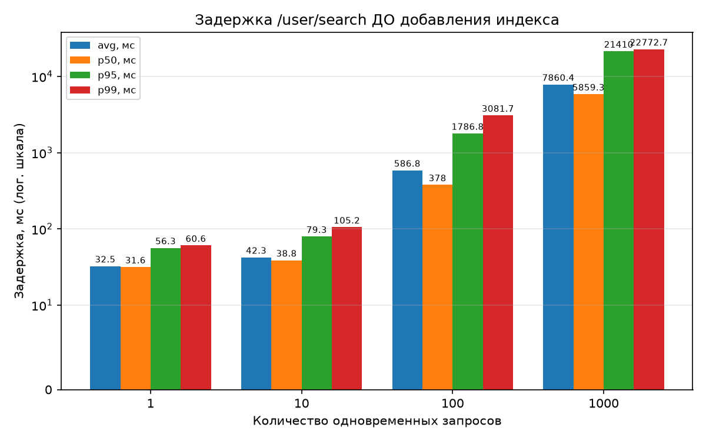
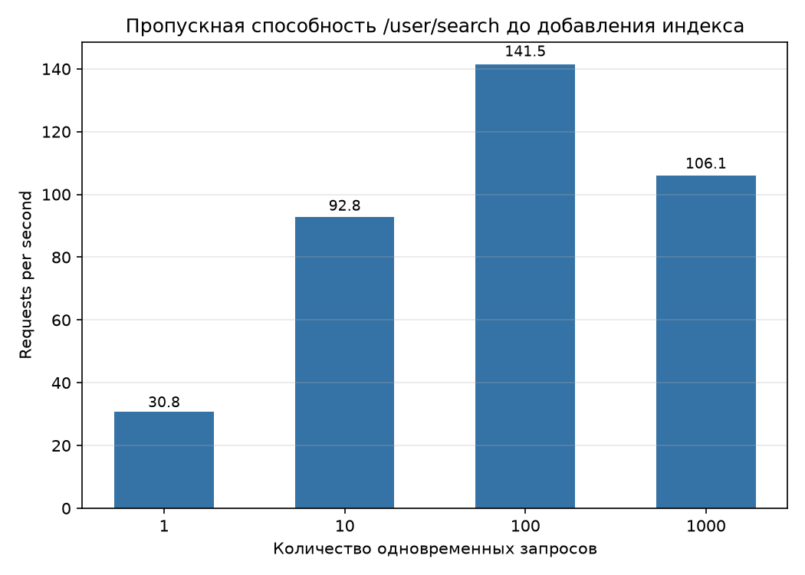
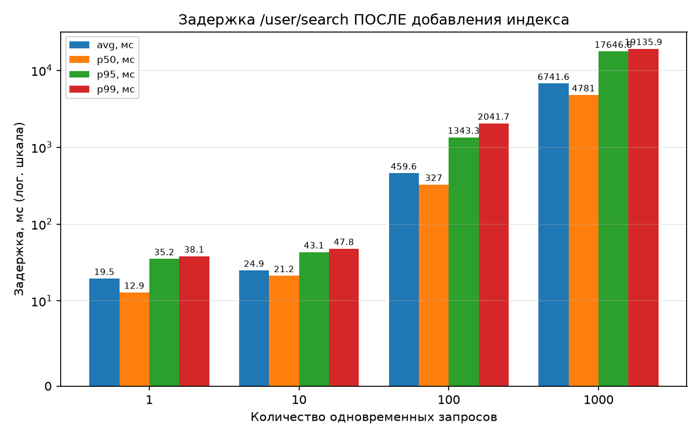
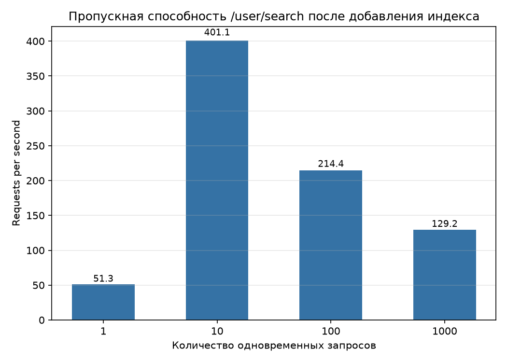
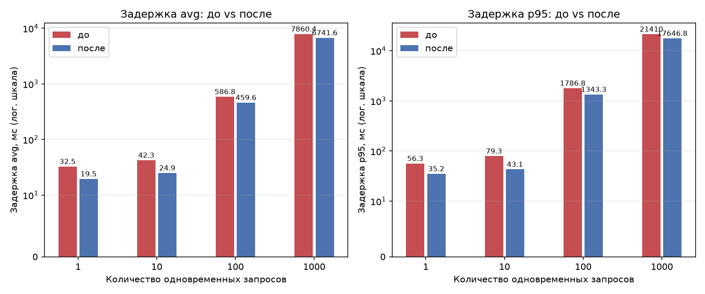
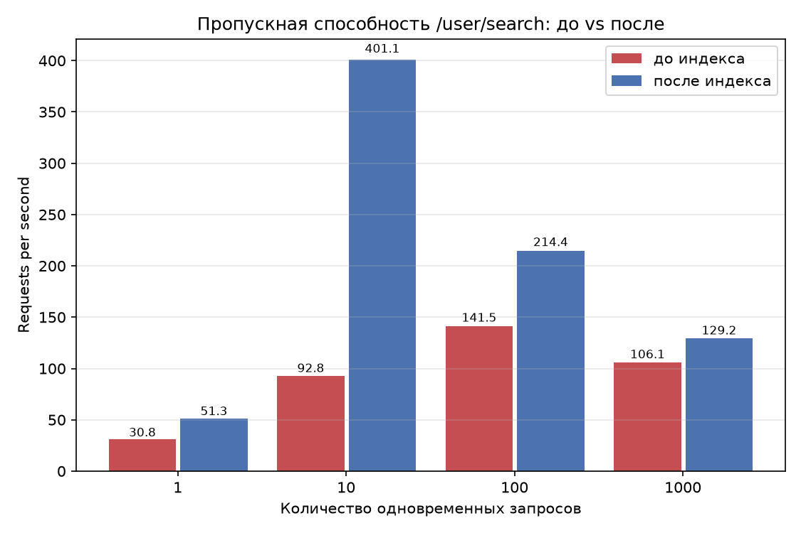

# Отчёт по ДЗ «Производительность индексов»

Скелет социальной сети из ДЗ №1 (FastAPI + PostgreSQL, без ORM), ветка `dev`.

## 1. Тестовые данные

`scripts/generate_data.py` сгенерировал 1 000 000 анкет. Имена и фамилии —
реальные русские, у каждого свой вес частотности: Анна встречается у 2,8 %
пользователей (28 437 человек), фамилия Иванова у 2,4 % (23 690). Пол и форма
фамилии согласованы — женским анкетам достаются фамилии с окончанием на `-а`
(Иванов → Иванова). Дата рождения равномерно разбросана по 1950–2020 годам,
города и интересы взяты из реальных списков.

Как распределение выглядит в сумме:

| Показатель | Значение |
|---|---|
| Всего строк | 1 000 000 |
| Различных имён | 106 |
| Различных фамилий | 104 |
| Самое частое имя | Анна (28 437) |
| Самая частая фамилия | Иванова (23 690) |

## 2. Что ищем

Метод из спецификации:

```
GET /user/search?first_prefix=Ан&last_prefix=Ив&limit=20
```

SQL (параметризованный, `%` на стороне приложения):

```sql
SELECT id, first_name, last_name, birth_date::text, gender, interests, city
FROM users
WHERE first_name LIKE %s AND last_name LIKE %s
ORDER BY id
LIMIT %s
```

## 3. Как тестировал

Тестировщик — `scripts/load_test.py` (asyncio + httpx). Базы и приложение не
менялись между прогонами *до* и *после*, кроме добавления индекса:

| Параметр | Значение |
|---|---|
| БД | PostgreSQL 18, Docker, отдельная машина (192.168.1.152) |
| Приложение | uvicorn, 4 воркера; пул БД по 20 соединений на воркер |
| Сценарий запросов | случайные пары префиксов разной селективности: частые («Ан»+«Ив»), средние («Се»+«См»), редкие («Ы»+«Ъ» — пустой результат) |
| Уровни параллелизма | 1 / 10 / 100 / 1000 |
| Разогрев / замер | 5 с / 15 с на точку |
| Метрики | RPS, avg/p50/p95/p99/max latency, ошибки |

Сырые результаты обеих фаз — `reports/loadtest_results.csv`.

## 4. Результаты

### 4.1 Задержка ДО добавления индекса (мс)



| Параллелизм | avg | p50 | p95 | p99 | max |
|---:|---:|---:|---:|---:|---:|
| 1 | 32,5 | 31,6 | 56,3 | 60,6 | 75,8 |
| 10 | 42,3 | 38,8 | 79,3 | 105,2 | 136,4 |
| 100 | 586,8 | 378,0 | 1786,8 | 3081,7 | 6218,1 |
| 1000 | 7860,4 | 5859,3 | 21410,0 | 22772,7 | 23736,6 |

### 4.2 Пропускная способность до добавления индекса (RPS)



| Параллелизм | RPS | Ошибки |
|---:|---:|---:|
| 1 | 30,8 | 0 |
| 10 | 92,8 | 2 (таймаут клиента) |
| 100 | 141,5 | 0 |
| 1000 | 106,1 | 0 |

### 4.3 Задержка ПОСЛЕ добавления индекса (мс)



| Параллелизм | avg | p50 | p95 | p99 | max |
|---:|---:|---:|---:|---:|---:|
| 1 | 19,5 | 12,9 | 35,2 | 38,1 | 40,9 |
| 10 | 24,9 | 21,2 | 43,1 | 47,8 | 57,2 |
| 100 | 459,6 | 327,0 | 1343,3 | 2041,7 | 3370,0 |
| 1000 | 6741,6 | 4781,0 | 17646,8 | 19135,9 | 19571,5 |

### 4.4 Пропускная способность после добавления индекса (RPS)



| Параллелизм | RPS | Ошибки |
|---:|---:|---:|
| 1 | 51,3 | 0 |
| 10 | 401,1 | 0 |
| 100 | 214,4 | 0 |
| 1000 | 129,2 | 0 |

### 4.5 До и после





| Параллелизм | RPS до → после | Прирост RPS | p95 до → после (мс) | Снижение p95 |
|---:|---|---:|---|---:|
| 1 | 30,8 → 51,3 | ×1,67 | 56,3 → 35,2 | −37 % |
| 10 | 92,8 → 401,1 | ×4,32 | 79,3 → 43,1 | −46 % |
| 100 | 141,5 → 214,4 | ×1,52 | 1786,8 → 1343,3 | −25 % |
| 1000 | 106,1 → 129,2 | ×1,22 | 21410,0 → 17646,8 | −18 % |

## 5. Индекс

`scripts/create_indexes.sql`, тот же блок закомментирован в `init.sql`:

```sql
CREATE INDEX CONCURRENTLY IF NOT EXISTS idx_users_first_name_last_name_pattern
    ON users (first_name varchar_pattern_ops, last_name varchar_pattern_ops);

ANALYZE users;
```

## 6. Планы запросов

Полные планы: `reports/explain_before.txt`, `reports/explain_after.txt`.

Частые префиксы (`LIKE 'Ан%' AND LIKE 'Ив%'`) планировщик обрабатывает
одинаково и до, и после — Index Scan по PK с остановкой на LIMIT 20 (0,5 мс).
Здесь индекс ничего не меняет.

Худший случай (`LIKE 'Ы%' AND LIKE 'Ъ%'`, ноль результатов) — тот, ради
которого индекс и делали. До:

```
->  Sort (actual time=18.470..20.034 rows=0.00 loops=1)
      ->  Gather  (Workers Launched: 2)
            ->  Parallel Seq Scan on users  (actual time=17.096..17.096 rows=0.00 loops=3)
                  Filter: ((first_name ~~ 'Ы%'::text) AND (last_name ~~ 'Ъ%'::text))
                  Rows Removed by Filter: 333334
```

После:

```
Limit  (actual time=0.043..0.043 rows=0.00 loops=1)
  ->  Sort (actual time=0.042..0.042 rows=0.00 loops=1)
        ->  Index Scan using idx_users_first_name_last_name_pattern on users
              (actual time=0.032..0.032 rows=0.00 loops=1)
              Index Cond: ((first_name ~>=~ 'Ы'::text) AND (first_name ~<~ 'Ь'::text)
                       AND (last_name ~>=~ 'Ъ'::text) AND (last_name ~<~ 'Ы'::text))
              Filter: ((first_name ~~ 'Ы%'::text) AND (last_name ~~ 'Ъ%'::text))
```

20 мс → 0,05 мс (≈380×), а чтение из heap сократилось с 19 063 до 8 буферов.
`LIKE 'Ы%'` заменился парой индексных условий `~>=~/~<~` — так планировщик
использует класс операторов `_pattern_ops` для префиксного поиска.

## 7. Почему выбран такой индекс

1. **Составной (first_name, last_name), а не два отдельных.** Поиск требует
   префикса обеих колонок сразу. В составном индексе first_name задает диапазон
   сканирования, а last_name фильтруется вторым ключом прямо в индексе, без
   похода к строкам таблицы. Два одиночных индекса означают bitmap AND,
   лишний проход по heap и недоиспользованный второй столбец.

2. **`varchar_pattern_ops`, а не дефолтный класс операторов.** База создана в
   не-C локали; обычный btree упорядочен по правилам локали, поэтому
   планировщик не может превратить `LIKE 'Ы%'` в диапазон. `pattern_ops`
   хранит посимвольный порядок — в EXPLAIN видно, как префикс стал двумя
   диапазонными условиями. Без этого класса индекс просто не работал бы с LIKE.

3. **`CONCURRENTLY` и `ANALYZE`.** Таблица уже содержит анкеты пользователей,
   поэтому индекс строим без эксклюзивной блокировки чтения; `ANALYZE` дает
   планировщику актуальную статистику.

4. **`id` в индекс не включил.** `ORDER BY id` сортирует не более LIMIT строк
   выбранного диапазона (quicksort на 25 кБ) — это миллисекунды после выборки
   по индексу. Порядок по first_name/last_name не совпадает с порядком id,
   так что id в ключе не избавил бы от сортировки, лишь раздуло бы индекс.

### Почему прирост сквозного RPS скромнее ускорения запроса

На одиночном редком запросе индекс дает ~380×, но сквозной RPS вырос лишь в
1,2–4,3 раза. Причина в том, что после добавления индекса узким местом
перестал быть SELECT: теперь запрос упирается в слой приложения — HTTP-сервер
uvicorn, Python-обработку и пул БД (80 соединений на 1000 клиентов), плюс
сетевые задержки. Наибольший прирост (×4,32) получен при параллелизме 10,
где приложение еще не насыщено; на уровнях 100/1000 насыщение съедает часть
выигрыша в RPS, падение хвостовых задержек (p95, −18…−46 %) остается
ощутимым.

## 8. Выводы

- Индекс `(first_name varchar_pattern_ops, last_name varchar_pattern_ops)`
  покрывает запрос поиска по префиксу имени и фамилии: редкие префиксы
  отрабатывают за 0,05 мс вместо 20 мс с полным сканом миллиона строк,
  чтение heap — 8 буферов вместо 19 063.
- Сквозной throughput — до ×4,32; хвостовые задержки — минус 18–46 % в
  зависимости от уровня параллелизма.
- Следующие узкие места уже не в SQL: это HTTP-слой uvicorn, синхронный
  psycopg2 и размер пула соединений. Их доработка даст больше, чем любое
  дальнейшее изменение схемы БД.

## Приложение. Файлы

| Файл | Назначение |
|---|---|
| `scripts/generate_data.py` | генерация 1 млн анкет |
| `scripts/load_test.py` | нагрузочный тест /user/search (1/10/100/1000) |
| `scripts/make_charts.py` | построение графиков из `loadtest_results.csv` |
| `scripts/create_indexes.sql` | создание индекса (дублируется закомментировано в `init.sql`) |
| `scripts/explain_query.py` | снятие EXPLAIN (ANALYZE, BUFFERS) |
| `reports/loadtest_results.csv` | сырые результаты обеих фаз |
| `reports/explain_before.txt` / `explain_after.txt` | планы запросов до/после |
| `reports/*.png` | графики из разделов 4 и 4.5 |
